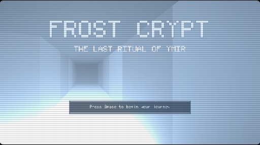
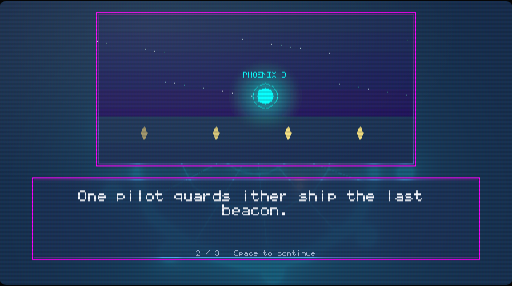
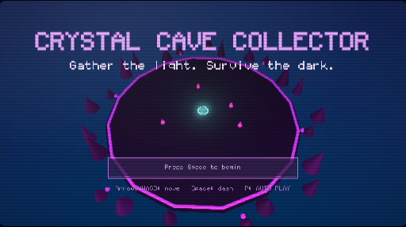
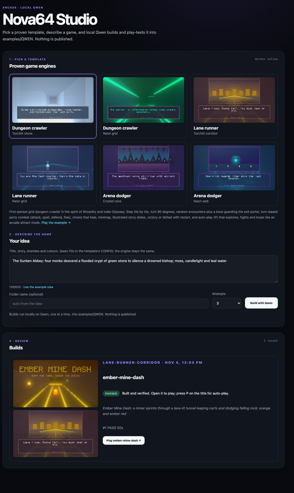
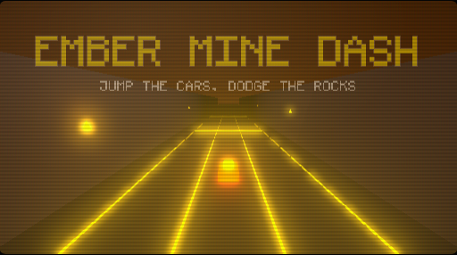

# I Taught a Local AI to Make Retro Games. The Trick Was Giving It Less to Do.

*How a Qwen model running on my Mac went from black screens to first-try playable games on Nova64, and how I put it behind one button in my personal concierge dashboard.*

---

I wanted to know whether a model running entirely on my own machine (no API key, no cloud, no per-token bill) could make games that are *good*. I didn't mean a tech demo. I meant something with a title screen, a story, real controls, and enough atmosphere that you'd want to keep playing.

The answer turned out to be yes. But the way it got there surprised me, and I think the lesson applies well beyond games.

## The setup

There are three pieces.

**[Nova64](https://nova64.io)** is a fantasy console for the browser, in the spirit of PICO-8, but built for low-poly 3D with a retro look. A game ("cart") is a single JavaScript file with `init`, `update` and `draw`, plus a friendly API for meshes, lights, particles, sound and pixel-art UI. It's small enough for a model to hold in its head and expressive enough to make something that looks like a real game.

**Qwen3-30B-A3B Instruct**, quantized to 6-bit and served locally with MLX on an Apple Silicon Mac. It's a mixture-of-experts model, so it's quick for its size, and it writes JavaScript well.

**My concierge**, a self-hosted personal-ops stack I run at home: a locked-down dashboard, a few OpenClaw agents and a set of small worker jobs. I use it for publishing, research and site maintenance. Games would be its newest department.

I set one rule at the start: **Qwen writes games, not the platform.** It never touches the Nova64 runtime or API, only cart files, and only inside a single `examples/QWEN/` folder. I enforced that in code instead of trusting the prompt.

## Round one: freedom, and chaos

I started the way most people would. I wrote a strong persona ("you're a creative technologist who makes Nova64 games"), gave Qwen the API reference and a couple of example carts, and asked for a game.

The results were… educational.

- **Black screens.** Qwen cleared the 2D overlay every frame in a 3D game, painting over the whole scene.
- **A white screen.** It wrote `this.flash` in one place and `flash` in another, so a flash effect stuck on forever.
- **Invented imports.** It confidently imported functions that don't exist, or imported real ones from the wrong module.
- **Ragged dungeon maps.** Asked to draw an ASCII maze, it produced rows of different lengths, then got stuck repeating the same row.

One of the early games took **nine attempts** to go from a black screen to "a single glowing dot on a dark background." It technically ran, but it wasn't something you'd want to play.

## Round two: a harness that tells the truth

The first real improvement was a test loop that doesn't let anything slide. Every attempt goes through a checker that:

1. Lints the cart for undefined names.
2. Verifies every API call against Nova64's real namespace map.
3. Rejects forbidden patterns: imports, `eval`, network calls, `this.` inside hooks, and patching the runtime.
4. **Boots the game in a headless browser,** presses Start, plays a little with the arrow keys and takes screenshots.
5. Measures the screenshots. A frame that's nearly all one colour counts as a failure, however clean the code looks.

Any failure goes back to Qwen as a specific repair note, and it tries again. Lessons that keep coming up go into a short `lessons.md` that every future prompt includes: "never call `cls()` in `draw()` for a 3D cart," "rotate floor planes −90° on X," "keep game state in module-level variables."

I also took one job away from Qwen entirely: **imports.** The runner deletes whatever imports Qwen writes and generates the correct ones from the names the cart actually uses. A whole category of bugs disappeared overnight.

Things got much more reliable. But the games were still, in a word, *strange*.

## Round three: give the model less to do

The breakthrough was obvious in hindsight.

Qwen isn't bad at games. It's bad at doing *everything at once*: inventing mechanics, balancing them, building a maze, writing a combat system, designing a HUD and choosing an art direction in one go. Any one of those can sink the whole game.

So I wrote **templates.** Each one is a complete, hand-tested game engine with a clearly marked `CONFIG` section at the top. Qwen writes **only the CONFIG**: the title, the story slides, the party, the enemies, the palette, the lighting mood and the difficulty. The engine handles everything else: movement, collisions, the seeded maze generator, combat, the minimap, story-slide art and an **auto-play mode** that plays the game by itself like an arcade attract screen.

I ended up with six templates across three genres:

| Genre | Styles |
|---|---|
| First-person dungeon crawler (Wizardry-style party, turn-based combat, boss and exit portal) | Torchlit stone, Neon grid |
| Three-lane runner (fair generated rows, jumps, shields, combos) | Torchlit corridor, Neon grid |
| Top-down arena dodger (dash, gems, telegraphed enemy waves) | Crystal cave, Neon web |

The difference was night and day.

| Game | Before (free-form) | After (template) |
|---|---|---|
| Neon Orbit Dodger | 9 attempts; ended as a glowing dot | **Passed first try, 56 s** |
| Crystal Cave Collector | Washed-out teal screen, no title | **Passed first try, 32 s** |
| Frost Crypt of Ymir | — | **Passed first try, 56 s** |
| Neon Archive | — | Passed on attempt 2, 42 s |
| Ember Mine Dash | — | **Passed first try, 50 s** |

The checker still guards the CONFIG. It makes sure every required setting exists, flags pure-black colours that vanish on a dark background, and rejects layouts the maze generator can't use. The engine has its own guardrails too, such as capping surface brightness so a "make it glow!" palette can't wash the screen out.

What surprised me most is how much *personality* survives. Given a one-line idea, Qwen picked "Amethysts" as the collectible in a cave game and wrote the tagline *"Gather the light. Survive the dark."* It named a dungeon after a frost giant and wrote a three-slide story about a party descending to find the last exit. The template keeps the structure solid, which leaves the model free to be creative.

**The general lesson:** when a local model struggles with a big creative task, don't keep making the prompt bigger. Find the parts that need to be *correct* and do them in code. Then hand the model the parts that need to be *interesting*.

## Putting it behind a button

Running builds from a terminal is fine for me. I wanted it to be as easy as ordering coffee, so I added a **Nova64 Studio** page to my concierge dashboard.

1. **Pick a template.** Each card shows a real screenshot and links to an example game.
2. **Describe the game** in a sentence or two, or start from a suggested idea.
3. **Build with Qwen.** The build appears in a list with live status, attempt count, the checker's notes and title and gameplay screenshots. When it passes, you get a **Play** button.

Under the hood it uses the same pattern as every other job in my concierge, and I'd recommend it to anyone wiring AI into a home setup:

- The dashboard runs in a container and **can't run anything itself.** It writes a small request file with a strict shape: a request ID, a template from a fixed list of six, an idea of at most 600 characters, an optional folder name and an attempt count. No free-form commands, ever.
- A small worker on the Mac picks up requests one at a time, runs Qwen and the checker, and writes back status and screenshots.
- The dashboard only *reads* those results. Every action is authenticated and CSRF-protected, and the system cannot publish anything. Builds never overwrite an existing game, and nothing leaves the machine.

My first test from the dashboard was "Ember Mine Dash": *a miner sprints through a lava-lit tunnel, leaping carts and dodging falling rock; orange and ember red.* It passed on the first attempt in 50 seconds, title screen and all.

## What I'd tell you if you're trying this

- **Local models are ready for creative work, if you give them the right job.** A 30B mixture-of-experts model on a laptop wrote all of these games. The engines did the hard, exacting parts.
- **Test the thing people actually experience.** Linting caught typos, but only screenshots caught a black screen.
- **Turn recurring mistakes into code, not prompt paragraphs.** Imports, maps and brightness were all better handled by the runner than by more instructions.
- **Draw hard lines.** "The model writes carts, never the runtime" made the whole project easier to trust and easier to review.
- **Make it fun to use.** Auto-play, story slides and a one-click Play button turned a pipeline into something I actually *enjoy* opening.

## What's next

A top-down shooter template is on the drawing board. I'm also connecting the concierge's chat agent to the same build queue, so I can say "make me a spooky lighthouse runner" from my phone and come back to a playable game.

If you like fantasy consoles, low-poly retro 3D or small weekend game projects, **check out [Nova64 at nova64.io](https://nova64.io).** It's a delightful sandbox whether you're writing carts by hand or teaching a model running on your own machine to write them for you.

*Thanks for reading. If you build something with Nova64 or a local model, I'd love to see it.*

---

*Tags: AI · Game Development · Local LLM · JavaScript · Indie Games*
